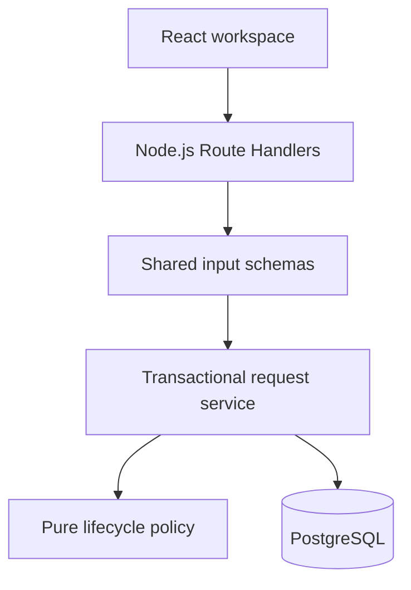

# ReturnDesk: Frozen System Architecture & Implementation Specification

**Target Assignment:** Frido Full-Stack Software Developer Intern Take-Home Assignment (`ReturnDesk`, 24-Hour Build)
**Status:** Final implementation baseline — reviewed against the supplied assignment and conversation; not implemented or runtime-verified.

**Authority:** The assignment PDF controls mandatory requirements. This document fixes implementation choices and records assumptions. Research connections are adaptations of the supplied literature summaries, not independently verified paper claims or promised performance gains. Further changes require a concrete implementation finding, not additional feature brainstorming.

## 1. Product Vision & Frozen Scope

**Core Experience:**
> **Searchable queue $\rightarrow$ clear request workspace $\rightarrow$ guided decision $\rightarrow$ reliable feedback.**
> ReturnDesk helps support agents resolve customer returns with confidence. It presents only legal next actions, explains decision requirements before confirmation, and keeps the React interface, Node.js API, and PostgreSQL database consistent—even when requests are updated concurrently across browser tabs.

### 1.1 Final Refinements Locked In Before Coding

| Area | Issue Resolved from Earlier Drafts | Frozen Implementation Rule |
| :--- | :--- | :--- |
| **Public References** | `LPAD(reference_number::text, 6, '0')` truncates values longer than 6 characters (`1000000` $\rightarrow$ `100000`). | Pad to *at least* 6 characters using `GREATEST(6, LENGTH(reference_number::text))` so values grow cleanly beyond 6 digits (`RD-000001`, `RD-999999`, `RD-1000000`). Serialize database `BIGINT` identifiers as strings at the API boundary. |
| **Removal Column Name** | Drafts alternated between `removed_at` and `deleted_at`. | Standardize strictly on **`removed_at`** across SQL migrations, Drizzle schema, TypeScript types, API docs, and tests. |
| **Removal Guidance on `OPEN` Requests** | Recommending rejection solely to free an item conflates a business decision with desk housekeeping. | Explain the exact consequence neutrally in the confirmation dialog and suggest keeping the request on the desk if further processing is needed. Document the literal status-based behavior as the implemented design in `README.md`. |
| **Note Ordering & Concurrency** | Identity values provide a deterministic tie-breaker, not a universal guarantee of transaction commit order. | Promise **deterministic chronological display** (`ORDER BY created_at ASC, id ASC`) and lock the parent `return_requests` row (`FOR UPDATE`) during note insertion to serialize note writes against removal. |
| **Uniform Mutation Concurrency Protocol** | Combining row locks and `version` checks works only if every state mutation follows the exact same protocol. | Require `expectedVersion` in the JSON body for **all three** state mutations: detail edits (`PATCH`), transitions (`POST .../transitions`), and removal (`DELETE`). Notes lock the parent row to verify `removed_at IS NULL` without incrementing `version`. |
| **Research & Verification Claims** | Phrases like "zero cross-file drift" or "graders never fail" overstate guarantees; in-UI illegal action drawers conflict with UI rules. | Present shared contracts as **reducing contract drift**, literal SQL indexing as **following the brief's wording**, and tests as **direct evidence against specified cases** (with zero illegal-action buttons in the UI). |

### 1.2 Frozen Scope Boundaries

| Priority | Included |
| :--- | :--- |
| **1. Mandatory Flows** | Raise request, combined server-side SQL search/filter/sort/pagination, request detail workspace, append-only chronological notes, all 5 server-enforced business rules, PostgreSQL persistence, 36-request seed script, `375px` responsive layout, public deployment, and accurate `README.md`. |
| **2. Core Engineering Quality** | Single authoritative write path, shared pure contracts, `NUMERIC(12,2)` string-serialized money (`INR ₹`) with strict 2-decimal and range bounds, transaction row locking + `expectedVersion` checks, 3-tier persistent inline error placement, and independently specified PostgreSQL tests. |
| **3. Extensions (Only After Core Passes)** | **First extension:** `request_events` lifecycle activity timeline written in the same transaction.<br>**Later extension:** Persistent idempotency keys for request creation and note creation. |
| **4. Excluded** | AI refund recommendations, analytics dashboards, separate microservices/queues, in-UI reviewer illegal-action drawers, authentication walls, and payment/shipping integrations. |

## 2. Research-Informed Development Process (Without Adding AI Bloat)

We adapt engineering workflows from your supplied 2024–2026 literature review to structure how we specify, build, and verify the application—without adding LLM dependencies or agent frameworks to ReturnDesk:

| Source in Your Notes | Engineering Principle Adopted | Concrete Use in ReturnDesk |
| :--- | :--- | :--- |
| [TDDev (Paper 9)](https://arxiv.org/abs/2509.25297) | Define executable expectations before implementation | Write independent lifecycle, resolution, and duplicate-request PostgreSQL tests before wiring the UI screens. |
| [TheBotCompany (Paper 7)](https://arxiv.org/abs/2603.25928) | Separate planning, execution, and verification | Gate each vertical implementation slice with concrete test/SQL evidence before proceeding. |
| [ALMAS (Paper 10)](https://arxiv.org/abs/2510.03463) | Separate requirements and architecture from code generation | Freeze the rule matrix, mutation contract, and README assumptions before writing application code. |
| [AgileCoder (Paper 13)](https://arxiv.org/abs/2406.11912) & [SWE-Bench Pro (Paper 19)](https://arxiv.org/abs/2509.16941) | Reduce contract drift across dependent files | Keep pure types, Zod schemas, and lifecycle policy in `src/domain/requests/` and update validation, service, API response, and UI together. |
| [WebIGBench (Paper 15)](https://arxiv.org/abs/2606.00154) & [Interaction2Code (Paper 18)](https://arxiv.org/abs/2411.03292) | Verify post-interaction UI states | Inspect approval controls after toggling resolutions, preserve form inputs on failed submissions, and verify stale-version recovery. |
| [Automated Web Application Testing (Paper 20)](https://arxiv.org/abs/2506.02529) | Derive test scenarios from navigation and state graphs | Test every legal and illegal status transition edge and conditional form dependency. |
| [UI2Code^N (Paper 14)](https://arxiv.org/abs/2511.08195), [WAFFLE (Paper 17)](https://arxiv.org/abs/2410.18362) & [ArtifactsBench (Paper 5)](https://arxiv.org/abs/2507.04952) | Render, inspect, and refine across states | Verify desktop (`1280px`) and mobile (`375px`) layouts across loading, populated, empty, filtered-empty, and error states. |
| [WebCoderBench (Paper 1)](https://arxiv.org/abs/2601.02430) | Evaluate multiple quality dimensions separately | Audit business rule enforcement (25), data model (20), API design (20), frontend usability (20), code quality (10), and submission readiness (5). |

## 3. System Architecture & Single Authoritative Write Path

We build one **Next.js (App Router) + React + TypeScript** application with **Node.js Route Handlers**, **PostgreSQL**, **Drizzle ORM** (with committed SQL migrations), **Zod**, and **Tailwind CSS**.



* **One Authoritative Write Path:** All mutations flow exclusively through `Route Handler → Validation → Transactional Service → PostgreSQL`. We do not create a second mutation path via Server Actions or direct page-level database writes.
* **Pure Shared Boundary:** `src/domain/requests/` contains only pure TypeScript types, Zod schemas, and policy functions. Database connections, Drizzle queries, and transaction logic live strictly inside `src/server/`.

### 3.1 Repository Structure

```text
returndesk/
├── docker-compose.yml                  # Local PostgreSQL 16 setup
├── .env.example                        # Environment variable template
├── drizzle.config.ts                   # Drizzle Kit migration config
├── package.json                        # Scripts: dev, build, db:migrate, db:seed, test, test:e2e
├── README.md                           # Setup guide, live URL, architecture defense, assumptions, curl examples
├── drizzle/
│   └── 0000_initial_schema.sql         # Committed SQL migration
├── scripts/
│   └── seed.ts                         # Deterministic 36-request seed script
├── src/
│   ├── domain/
│   │   └── requests/                   # Pure shared contracts (safe for browser & server)
│   │       ├── types.ts                # Status, Reason, Resolution, Capabilities, DTO types
│   │       ├── schemas.ts              # Shared Zod schemas (whitespace trimming, decimal & contact validation)
│   │       └── policy.ts               # Legal transition matrix & capability derivation
│   ├── server/
│   │   ├── db/
│   │   │   ├── index.ts                # PostgreSQL connection pool
│   │   │   └── schema.ts               # Drizzle schema definitions matching 0000_initial_schema.sql
│   │   └── requests/
│   │       ├── service.ts              # Transactional mutations, row locking, version & rule checks
│   │       ├── queries.ts              # Parameterized SQL search, filter, sort, and pagination queries
│   │       └── errors.ts               # Domain/service error classes & PostgreSQL error mapping
│   ├── lib/
│   │   └── api/
│   │       └── response.ts             # Consistent JSON response and error helpers
│   ├── app/
│   │   ├── api/
│   │   │   └── requests/
│   │   │       ├── route.ts            # GET /api/requests, POST /api/requests
│   │   │       └── [id]/
│   │   │           ├── route.ts        # GET /api/requests/:id, PATCH /api/requests/:id, DELETE /api/requests/:id
│   │   │           ├── transitions/
│   │   │           │   └── route.ts    # POST /api/requests/:id/transitions
│   │   │           └── notes/
│   │   │               └── route.ts    # POST /api/requests/:id/notes
│   │   └── requests/
│   │       ├── page.tsx                # Queue screen (/requests)
│   │       ├── new/
│   │       │   └── page.tsx            # Create screen (/requests/new)
│   │       └── [id]/
│   │           └── page.tsx            # Request workspace (/requests/:id)
│   └── components/
│       └── requests/                   # Table, mobile cards, filter bar, decision panel, edit dialog, notes
└── tests/
    ├── policy.unit.test.ts             # Independently specified lifecycle & capability unit tests
    ├── requests.api.test.ts            # Real PostgreSQL integration & concurrency tests
    └── workspace.e2e.spec.ts           # Playwright browser tests (desktop + 375px mobile + two-tab conflict)
```

## 4. Frozen Business Rules, Mutation Contract & Assumptions (25 Points)

### 4.1 Status Lifecycle & Action Matrix

Internal status values are `OPEN`, `IN_REVIEW`, `APPROVED`, `REJECTED`, and `COMPLETED`. Removal (`removed_at`) is a separate visibility marker, not a lifecycle status.

| Current Status | Legal Next Statuses | Edit Request Details | Add Note* | Remove from Desk* | Resolution & Refund Amount |
| :--- | :--- | :--- | :--- | :--- | :--- |
| **`OPEN`** | `IN_REVIEW` | **Yes** | **Yes** | **Yes** | Must be absent (`NULL`) |
| **`IN_REVIEW`** | `APPROVED`, `REJECTED` | **Yes** | **Yes** | **No** (`409 REMOVAL_NOT_ALLOWED`) | Must be absent (`NULL`) |
| **`APPROVED`** | `COMPLETED` | **No** (`409 DETAILS_LOCKED`) | **Yes** | **No** (`409 REMOVAL_NOT_ALLOWED`) | Required & Immutable |
| **`REJECTED`** (Final) | *None* (`[]`) | **No** (`409 DETAILS_LOCKED`) | **Yes** | **Yes** | Must be absent (`NULL`) |
| **`COMPLETED`** (Final) | *None* (`[]`) | **No** (`409 DETAILS_LOCKED`) | **Yes** | **No** (`409 REMOVAL_NOT_ALLOWED`) | Retained & Immutable |

*\*Applies only to non-removed requests (`removed_at IS NULL`). Removed requests cannot be retrieved (`GET`), edited (`PATCH`), transitioned, noted, or removed again—all return `404 REQUEST_NOT_FOUND`.*

### 4.2 Complete Mutation Contract

1. **Uniform `expectedVersion` Requirement:**
   * `PATCH /api/requests/:id` (edit details), `POST /api/requests/:id/transitions` (change status), and `DELETE /api/requests/:id` (soft-remove) **all require `{ "expectedVersion": <positive integer> }` in their JSON request body**.
2. **Parent Locking on Every Operation:**
   * Every existing-request mutation (edits, transitions, removal, and note creation) begins a database transaction and runs `SELECT * FROM return_requests WHERE id = $1 AND removed_at IS NULL FOR UPDATE`.
3. **Notes Independence from Edit Version:**
   * Inserting a note (`POST /api/requests/:id/notes`) locks the parent row to confirm it is not removed and to serialize against a concurrent removal, but **does not check or increment `version`** so adding a note never invalidates another agent's open detail-edit form.
4. **Strict Field Allowlisting on `PATCH /api/requests/:id`:**
   * General `PATCH` accepts only `expectedVersion` and editable customer/item fields (`customerName`, `customerEmail`, `customerPhone`, `orderReference`, `itemIdentifier`, `itemName`, `quantity`, `reason`). Supplying `status`, `resolution`, `refundAmount`, `reference`, `referenceNumber`, or `removedAt` in `PATCH` is rejected by a strict Zod `.strict()` schema (`422 VALIDATION_ERROR`).
5. **Atomic Resolution Lifecycle:**
   * Transitioning `IN_REVIEW → APPROVED` is the **only** operation that sets `resolution` (`REFUND`, `REPLACEMENT`, or `STORE_CREDIT`) and `refundAmount`.
   * Transitioning `APPROVED → COMPLETED` preserves the existing `resolution` and `refundAmount` untouched and rejects any attempt to modify them.
   * Transitioning to the same status (e.g., `OPEN → OPEN`) is refused with `409 INVALID_TRANSITION`.
6. **Whitespace & Contact Normalization:**
   * Before validation, all text fields are trimmed, and whitespace-only contact strings (`customerEmail: "   "`, `customerPhone: "  "`) are normalized to `null`. At least one non-empty contact field is required by both Zod and the PostgreSQL `chk_customer_contact_present` constraint.
7. **Money Precision & Bounds Validation:**
   * `refundAmount` is transported as a decimal string (`"1499.00"`). Zod explicitly rejects strings with more than two fractional digits (e.g., `"1499.999"`), non-positive values (`<= 0`), or values exceeding `9999999999.99` (`NUMERIC(12, 2)` max) with `422 VALIDATION_ERROR` before PostgreSQL can round or overflow.

### 4.3 Measurable Division of Enforcement

| Invariant | Transactional Service (`service.ts`) | PostgreSQL (`0000_initial_schema.sql`) |
| :--- | :--- | :--- |
| **Only legal status transitions** | **Yes** (validates current $\rightarrow$ target status while row is locked) | Enum type check (transition graph intentionally kept in service) |
| **Approved/final details cannot be edited** | **Yes** (refuses `PATCH` when status is `APPROVED`, `REJECTED`, or `COMPLETED`) | Not enforced by static column/version constraints; enforced by the service |
| **Resolution & refund amount consistency** | **Yes** (validates on approval and preserves on completion) | **Yes** (null-safe `CHECK` constraints `chk_resolution_by_status` & `chk_refund_amount_by_resolution`) |
| **Positive integer quantity & contact presence** | **Yes** (Zod validation + whitespace normalization) | **Yes** (`INTEGER` type + `chk_positive_quantity` + `chk_customer_contact_present`) |
| **One live request per order/item (create & edit)** | Maps SQLSTATE `23505` only for `one_live_request_per_order_item` to `409 LIVE_REQUEST_EXISTS`; other unique violations are not mislabelled | **Yes** (partial unique index `one_live_request_per_order_item` on `(order_key, item_key) WHERE status IN ('OPEN', 'IN_REVIEW', 'APPROVED')`) |
| **Notes are append-only** | Exposes note creation via POST and note reads inside request detail; no note edit/delete routes | **Yes** (`trg_request_notes_append_only` blocks `UPDATE` and `DELETE`; `ON DELETE RESTRICT` on FK) |
| **Removed records cannot be accessed** | **Yes** (`WHERE removed_at IS NULL` check on list, detail, note, and mutation queries) | Stores `removed_at TIMESTAMPTZ NULL` |

### 4.4 Explicit README Assumptions

* **Implemented Removal Semantics (Rule 3 $\times$ Rule 5):** Following the literal wording of Rule 3 (*"has not yet reached Rejected or Completed"*), a request remains live until its status becomes `REJECTED` or `COMPLETED`. Removing an `OPEN` request sets `removed_at` and hides it from the application, while its status remains `OPEN` in PostgreSQL and continues to block another request for the same order and item. (Releasing the item upon removal of an `OPEN` request was considered as an alternative product design, but is not implemented so the status-based definition of "live" is strictly preserved.)
* **Standalone Store Context:** Order references belong to a single store (`INR ₹` currency), and `(order_key, item_key)` uniquely identifies an item within an order without requiring an external e-commerce integration or login wall.

## 5. PostgreSQL 16 DDL Blueprint (20 Points)

```sql
CREATE TYPE return_status AS ENUM (
  'OPEN',
  'IN_REVIEW',
  'APPROVED',
  'REJECTED',
  'COMPLETED'
);

CREATE TYPE return_reason AS ENUM (
  'DAMAGED',
  'WRONG_ITEM',
  'SIZE_ISSUE',
  'NOT_AS_DESCRIBED',
  'CHANGED_MIND'
);

CREATE TYPE return_resolution AS ENUM (
  'REFUND',
  'REPLACEMENT',
  'STORE_CREDIT'
);

CREATE SEQUENCE IF NOT EXISTS return_request_ref_seq START WITH 1001 INCREMENT BY 1;

CREATE TABLE return_requests (
  id UUID PRIMARY KEY DEFAULT gen_random_uuid(),

  -- Concurrency-safe sequence + non-truncating formatted public reference
  reference_number BIGINT NOT NULL UNIQUE DEFAULT nextval('return_request_ref_seq'),
  reference VARCHAR(32) GENERATED ALWAYS AS (
    'RD-' || LPAD(
      reference_number::text,
      GREATEST(6, LENGTH(reference_number::text)),
      '0'
    )
  ) STORED UNIQUE,

  -- Customer contact snapshot
  customer_name VARCHAR(120) NOT NULL,
  customer_email VARCHAR(255) NULL,
  customer_phone VARCHAR(40) NULL,

  -- Order & Item identity with database-generated normalized keys
  order_reference VARCHAR(64) NOT NULL,
  order_key TEXT GENERATED ALWAYS AS (LOWER(TRIM(order_reference))) STORED,
  item_identifier VARCHAR(64) NOT NULL,
  item_key TEXT GENERATED ALWAYS AS (LOWER(TRIM(item_identifier))) STORED,
  item_name VARCHAR(200) NOT NULL,
  quantity INTEGER NOT NULL,
  reason return_reason NOT NULL,

  -- Lifecycle & Resolution fields
  status return_status NOT NULL DEFAULT 'OPEN',
  resolution return_resolution NULL,
  refund_amount NUMERIC(12, 2) NULL,

  -- Optimistic concurrency version
  version INTEGER NOT NULL DEFAULT 1,

  -- Audit & Soft Removal timestamps
  created_at TIMESTAMPTZ NOT NULL DEFAULT NOW(),
  updated_at TIMESTAMPTZ NOT NULL DEFAULT NOW(),
  decided_at TIMESTAMPTZ NULL,
  completed_at TIMESTAMPTZ NULL,
  removed_at TIMESTAMPTZ NULL,

  -- Null-safe non-empty string checks
  CONSTRAINT chk_non_empty_required_text CHECK (
    LENGTH(TRIM(customer_name)) > 0
    AND LENGTH(TRIM(order_reference)) > 0
    AND LENGTH(TRIM(item_identifier)) > 0
    AND LENGTH(TRIM(item_name)) > 0
  ),

  -- Rejects both NULL and empty/whitespace-only contact strings
  CONSTRAINT chk_customer_contact_present CHECK (
    (customer_email IS NOT NULL AND LENGTH(TRIM(customer_email)) > 0)
    OR
    (customer_phone IS NOT NULL AND LENGTH(TRIM(customer_phone)) > 0)
  ),

  CONSTRAINT chk_positive_quantity CHECK (quantity > 0),
  CONSTRAINT chk_positive_version CHECK (version >= 1),

  -- Null-safe resolution presence check
  CONSTRAINT chk_resolution_by_status CHECK (
    (
      status IN ('OPEN', 'IN_REVIEW', 'REJECTED')
      AND resolution IS NULL
      AND refund_amount IS NULL
    )
    OR
    (
      status IN ('APPROVED', 'COMPLETED')
      AND resolution IS NOT NULL
    )
  ),

  -- Null-safe refund amount check
  CONSTRAINT chk_refund_amount_by_resolution CHECK (
    (
      resolution = 'REFUND'
      AND refund_amount IS NOT NULL
      AND refund_amount > 0
      AND refund_amount <= 9999999999.99
    )
    OR
    (
      resolution IS DISTINCT FROM 'REFUND'
      AND refund_amount IS NULL
    )
  )
);

-- Rule 3: Literal status-based partial unique index (removed_at intentionally omitted per documented rule)
CREATE UNIQUE INDEX one_live_request_per_order_item
  ON return_requests (order_key, item_key)
  WHERE status IN ('OPEN', 'IN_REVIEW', 'APPROVED');

-- Queue indexes for visible records
CREATE INDEX idx_return_requests_visible_created
  ON return_requests (created_at DESC, id DESC)
  WHERE removed_at IS NULL;

CREATE INDEX idx_return_requests_visible_status_reason
  ON return_requests (status, reason, created_at DESC, id DESC)
  WHERE removed_at IS NULL;

-- Append-only chronological notes
CREATE TABLE request_notes (
  id BIGINT GENERATED ALWAYS AS IDENTITY PRIMARY KEY,
  request_id UUID NOT NULL REFERENCES return_requests(id) ON DELETE RESTRICT,
  body TEXT NOT NULL CHECK (LENGTH(TRIM(body)) > 0 AND LENGTH(body) <= 4000),
  created_at TIMESTAMPTZ NOT NULL DEFAULT NOW()
);

CREATE INDEX idx_request_notes_chronological
  ON request_notes (request_id, created_at ASC, id ASC);

CREATE OR REPLACE FUNCTION prevent_note_mutation()
RETURNS TRIGGER AS $$
BEGIN
  RAISE EXCEPTION 'Return request notes are append-only and cannot be updated or deleted.';
END;
$$ LANGUAGE plpgsql;

CREATE TRIGGER trg_request_notes_append_only
  BEFORE UPDATE OR DELETE ON request_notes
  FOR EACH ROW EXECUTE FUNCTION prevent_note_mutation();
```

**Public Reference Boundary Verification:**

| Sequence Value (`reference_number`) | Generated `reference` |
| :--- | :--- |
| `1` | `RD-000001` |
| `999999` | `RD-999999` |
| `1000000` | `RD-1000000` |

## 6. REST API, Serialization & Error Contract (20 Points)

### 6.1 Serialization & Endpoint Contract

* **BIGINT String Serialization:** Database `BIGINT` values (`request_notes.id` and `reference_number` if returned) are serialized as strings in JSON (`"id": "101"`) to prevent JavaScript `Number` precision loss.
* **Money String Serialization:** `refundAmount` travels as a two-decimal string (`"1499.00"`) or `null`.
* **Routes:**
  * `GET /api/requests`: Server-side search (`q` with `%`, `_`, and `\` escaped), `status` filter, `reason` filter, allowlisted `sort` + `direction` with `, id DESC` tie-breaker, and `LIMIT/OFFSET` pagination (`page`, `pageSize` capped at 50) over `removed_at IS NULL`.
  * `POST /api/requests`: Create `OPEN` request (`201 Created`).
  * `GET /api/requests/:id`: Return visible request, chronological `notes` (`ORDER BY created_at ASC, id ASC`), and `capabilities` (`200 OK`).
  * `PATCH /api/requests/:id`: Edit undecided customer/item details with `{ expectedVersion, ... }` (`200 OK`).
  * `POST /api/requests/:id/transitions`: Transition status with `{ expectedVersion, toStatus, resolution?, refundAmount? }` (`200 OK`).
  * `POST /api/requests/:id/notes`: Append note with `{ body }` (`201 Created`).
  * `DELETE /api/requests/:id`: Soft-remove `OPEN` or `REJECTED` request with `{ expectedVersion }` (`204 No Content`, empty response body).

### 6.2 Consistent Error Envelope

```json
{
  "error": {
    "code": "STALE_REQUEST",
    "message": "This request changed after you opened it. Reload the latest details before trying again.",
    "fieldErrors": {},
    "details": {
      "expectedVersion": 3,
      "currentVersion": 4
    }
  }
}
```

| Situation | HTTP Status | Error Code |
| :--- | :--- | :--- |
| Malformed JSON or unparseable query syntax | `400` | `BAD_REQUEST` |
| Invalid field values, whitespace-only contacts, `>2` decimal places, or invalid approval resolution/amount | `422` | `VALIDATION_ERROR` |
| Unknown UUID or `removed_at IS NOT NULL` (on detail, edit, transition, note, or delete) | `404` | `REQUEST_NOT_FOUND` |
| Disallowed status transition (or self-transition) | `409` | `INVALID_TRANSITION` |
| Duplicate live `(order_key, item_key)` on create or detail edit | `409` | `LIVE_REQUEST_EXISTS` |
| Editing customer/item details when `APPROVED`, `REJECTED`, or `COMPLETED` | `409` | `DETAILS_LOCKED` |
| Attempting removal when `IN_REVIEW`, `APPROVED`, or `COMPLETED` | `409` | `REMOVAL_NOT_ALLOWED` |
| `expectedVersion` mismatch against current database `version` | `409` | `STALE_REQUEST` |
| Unexpected internal error | `500` | `INTERNAL_ERROR` |

## 7. Deliberate Interface & Operational Copy (20 Points)

* **Three-Question Screen Design:**
  * **Queue (`/requests`):** Answers *What needs attention?* via combined server-side search (350ms debounced + `AbortController`), status/reason filters, removable active filter chips, sort controls, desktop table (`≥768px`), and compact `375px` mobile cards without horizontal scrolling.
  * **Decision Workspace (`/requests/:id`):** Two-column desktop layout (Main content: customer/contact, order/item, reason, chronological notes; Right rail: current status, brief state explanation, legal next actions, and resolution summary). On `375px` mobile, the Decision Panel sits immediately after the request summary and before the notes.
* **Exact Approval Copy (`IN_REVIEW → APPROVED`):**
  > **Ready for a decision**
  > Choose how this return should be resolved. Approving locks the customer and item details.
  >
  > **Resolution summary**
  > Refund ₹1,499.00 for 1 unit of Comfort Cushion.
  > *This records the agreed resolution; it does not transfer money.*
* **Exact Removal Confirmation Copy for an `OPEN` Request:**
  > **Remove this request from the desk?**
  > It will disappear from the application, but its record will remain stored. Because it is still Open, another request for this order and item will remain blocked. Keep it on the desk if further processing is needed.
* **Three Error Placements & Uncertain Network Recovery:**
  * Field validation beside the input (`fieldErrors`); failed action inside the form/dialog; failed page load at the page level with **Retry**.
  * On an uncertain network failure after sending a write, preserve the draft input, inform the agent that the result could not be confirmed, and refetch the current request before encouraging another attempt.

## 8. Independent Verification & 24-Hour Slice Execution Plan

### 8.1 Independently Derived Test Cases (`tests/requests.api.test.ts`)

Expected test outcomes are written directly from the assignment brief—never computed by calling `LEGAL_TRANSITIONS` or `policy.ts` inside the test assertions:

1. **Exhaustive 5×5 Status Transition Matrix:** Verify the 4 legal transitions succeed and all 21 other status pairs (including self-transitions like `OPEN → OPEN` and jumps like `OPEN → COMPLETED`) return `409 INVALID_TRANSITION` and leave the database row unchanged.
2. **Reference 6-Digit Boundary Crossing:** Verify sequence values `1`, `999999`, and `1000000` generate `RD-000001`, `RD-999999`, and `RD-1000000` without truncation.
3. **Removed `OPEN` Request Blocking Duplicate:** Create an `OPEN` request, remove it (`DELETE`), attempt to create a new request for the same `(order_reference, item_identifier)`, and verify `409 LIVE_REQUEST_EXISTS` while the removed row remains in PostgreSQL with `removed_at IS NOT NULL`.
4. **Duplicate-Producing Detail Edit:** Create two `OPEN` requests on different items, attempt to `PATCH` the second request's `orderReference` and `itemIdentifier` to match the first, and verify `409 LIVE_REQUEST_EXISTS`.
5. **Two Concurrent Creates:** Fire two simultaneous `POST /api/requests` calls for the same normalized `(order_reference, item_identifier)` and verify exactly one returns `201` and one returns `409 LIVE_REQUEST_EXISTS`.
6. **Approve-vs-Edit & Stale-Version Races:** Load a request at `version: 2`, approve it (`version` becomes `3`), and verify a subsequent edit or transition carrying `expectedVersion: 2` returns `409 STALE_REQUEST` (and an edit carrying `expectedVersion: 3` returns `409 DETAILS_LOCKED`).
7. **Whitespace-Only Contact Fields:** Submit `customerEmail: "   "` and `customerPhone: "\t "` and verify `422 VALIDATION_ERROR` (and verify the DB constraint rejects empty strings in raw SQL).
8. **Literal Wildcard Escaping in Search:** Seed requests containing literal `%`, `_`, and `\` characters and verify `GET /api/requests?q=%` matches only literal `%` rather than all rows.
9. **Three-Decimal Refund Amount Rejection:** Attempt approval with `resolution: "REFUND"` and `refundAmount: "1499.999"` (or `"0.00"` or `"-10.00"`) and verify `422 VALIDATION_ERROR`.
10. **Notes After Removal & Append-Only Enforcement:** Remove a request, attempt `POST /api/requests/:id/notes`, and verify `404 REQUEST_NOT_FOUND`. Attempt direct SQL `UPDATE` and `DELETE` on `request_notes` and verify the database trigger raises an exception.

### 8.2 Six Implementation Slices (Hours 0–24)

| Slice | Built & Connected | Completion Evidence Before Advancing |
| :--- | :--- | :--- |
| **1. Foundation (Hours 0–3)** | Next.js + TS + Tailwind scaffold, `0000_initial_schema.sql` migration, Drizzle setup, early Vercel + Neon deployment. | Clean migration runs locally and on deployed PostgreSQL. |
| **2. Create & Find (Hours 3–7)** | Shared contracts (`src/domain/requests/`), `POST /api/requests`, `GET /api/requests` (escaped SQL search, filters, allowlisted sort + `id DESC`, paging). | Real PostgreSQL tests pass for creation, 6-digit reference boundary, concurrent duplicate creates, and combined list queries. |
| **3. Work the Lifecycle (Hours 7–11)** | `GET /api/requests/:id` and `POST /api/requests/:id/transitions` (`FOR UPDATE` lock, `expectedVersion`, resolution & decimal validation). | Independent 25-pair transition matrix and resolution/precision tests pass. |
| **4. Maintain the Record (Hours 11–14)** | `PATCH /api/requests/:id`, `POST /api/requests/:id/notes`, and `DELETE /api/requests/:id`. | Locked-detail, duplicate-edit, append-only note, removed-parent `404`, and removed-`OPEN` duplicate-blocking tests pass. |
| **5. Complete the Experience (Hours 14–20)** | `/requests` queue, `/requests/new`, and `/requests/:id` workspace (Decision Panel, honest removal dialog, 3-tier errors, stale conflict recovery, `375px` cards). | Browser verification at `1280px` and `375px` across loading, empty, filtered, error, and two-tab stale conflict flows. |
| **6. Seed & Submission (Hours 20–24)** | 36-request deterministic seed (`scripts/seed.ts` with safe repeat-run behavior), runnable API examples, accurate `README.md`, clean-machine setup rehearsal. | Fresh clone setup works from scratch; live URL verified with seeded data. |


## 9. Final Contract Details and Integration Decisions

### 9.1 Validation, partial updates and errors

- Request creation accepts only documented customer, order, item, quantity and reason fields. Status, reference, resolution, version and timestamps are server-owned.
- PATCH is a genuine partial update: omitted fields stay unchanged; explicit null clears an optional contact. Validate the merged record after locking it, so clearing the last remaining contact fails with 422. Reject a PATCH containing no editable fields. Freeze all listed detail fields, including reason and quantity, once decided.
- Normalize leading/trailing whitespace on user text; normalize empty optional contact strings to null. Database TRIM-based checks cover space-only values; application validation also covers tabs/newlines. Do not claim SQL TRIM alone rejects every Unicode whitespace character.
- Quantity is a positive PostgreSQL INTEGER, maximum 2147483647. The earlier arbitrary 10000-unit cap is removed because the assignment supplies no such business restriction.
- Money accepts ordinary unsigned decimal strings with at most two fractional digits, then canonicalizes to two digits. Reject exponent notation, non-finite values, numeric JSON values, non-positive refunds and values above 9999999999.99. Compare using decimal/integer-minor-unit logic, not floating-point arithmetic.
- Non-refund approvals may omit refundAmount or send null; no numeric amount, including zero, is accepted. Other transition payloads must not carry resolution changes.
- Error precedence: parse/shape validation; visible parent lookup; expectedVersion check; transition/edit/removal eligibility; merged and operation-specific validation; write. Test forbidden transitions with structurally valid payloads and a current version.
- Malformed UUID path values return 400 BAD_REQUEST; well-formed missing UUIDs return 404 REQUEST_NOT_FOUND. Invalid field values and unknown body keys return 422. DELETE success is always 204 with no JSON body. Its expectedVersion JSON body is an intentional API convention and must be covered by deployed integration checks and curl examples.
- Catch transaction failures outside the transaction. A unique violation aborts the transaction; do not attempt a follow-up lookup inside that failed transaction. A blocking reference is optional and only exposed for a still-visible blocker; hidden records are not returned through conflict details.
- Creation has no existing parent to lock: its concurrency protection is the database unique index. All existing-parent writes follow the shared locking protocol.
- Service updates explicitly maintain updated_at, decided_at on approval/rejection, and completed_at on completion. Notes do not change the request version or detail updated_at. These timestamps are service-maintained, not automatic lifecycle enforcement by the database.

### 9.2 Success responses, queries and client state

- Single-resource responses use `{ "data": ... }`; list responses use `{ "data": [...], "pagination": { "page": 1, "pageSize": 10, "total": 36, "totalPages": 4 } }`. Note creation returns the new note. All dates serialize as ISO 8601 strings; nullable values remain null.
- Default list order: createdAt descending, then id descending. Allowlist createdAt, updatedAt, reference and customerName; reference sorting uses reference_number. Status/reason values are exact enums. page and pageSize are positive integers, pageSize at most 50; reject invalid values with 422.
- Search reference, customer name/email/phone, order reference, item name and item identifier. Bind all values as parameters. Escape literal backslash, percent and underscore once and test the actual query builder output. Do not concatenate identifiers from user input.
- Page data and total count use the same filters and one consistent database snapshot (one statement or a short read-only repeatable-read transaction). Out-of-range pages return an empty data array and the actual count, not a false zero count.
- URL parameters preserve queue state across navigation and refresh. Reset page to 1 when query/filter/sort/pageSize changes. After removal empties the current page, navigate to the last valid page and refetch.
- Use one client data owner per screen. Cancel or ignore obsolete reads. Mutations refetch affected detail/list data. Operational responses must not serve stale cached request state.
- Capabilities are derived from the current server record and are presentation hints; they never replace mutation enforcement.

### 9.3 Retry boundaries

- Never blindly retry a mutation after a timeout. Preserve inputs and explain that its outcome is uncertain.
- Edits/transitions can be reconciled against the current record and version; a 404 after removal confirms absence from the desk, not who performed the removal.
- Creation may have no returned ID. Search the order/item and inspect possible matches; do not assert that a matching record proves this particular submission succeeded.
- Identical note text does not prove whether a specific note submission succeeded. Reload the notes and ask the agent to inspect before explicitly resubmitting. Exactly-once creation/note semantics are not claimed; persistent idempotency remains an extension.

## 10. Seed, Delivery and Acceptance Freeze

### 10.1 Exactly 36 visible seeded requests

- 25 rows: one for each of the five statuses crossed with each of the five reasons.
- 4 rows: two historical/live pairs, each consisting of a terminal request and a new live request for the same order/item.
- 7 rows: additional long-label, contact and resolution examples.
- All 36 are visible initially. Add notes to several records, including final records, and cover all three resolution types. Removed-record fixtures belong in the isolated test database, not this visible count.
- Seed only a clean database in one transaction; if application rows already exist, stop with a clear non-destructive message. Do not silently reset, overwrite reviewer changes or resurrect removed rows. Document how to reset a disposable local database explicitly.
- Build the seed alongside the database/API slices and load it before UI verification; the final submission slice rehearses it rather than implementing it for the first time.

### 10.2 Submission checklist

- Start from create-next-app; no admin/ticketing/CRUD template and no generated backend-as-a-service CRUD endpoints.
- Public GitHub repository with genuine incremental commits, complete source, lockfile, migrations, seed and test scripts. No ZIP submission.
- Deployed URL works without an authentication wall, uses persistent PostgreSQL and has seed data loaded. Use synthetic demo data only; this is not a production authentication design.
- README includes live URL, clean-machine setup, database creation/migration/seed instructions, test commands, design decisions, all assumptions, incomplete work and actual hours spent. Repository description includes the live URL.
- .env.example lists every required variable; real credentials stay out of source control. Separate test and deployed database URLs. Tests and cleanup scripts must never target the demo database.
- Pin dependency versions during implementation; use a Node-compatible database driver supporting interactive transactions on the selected host. Verify migration configuration and generated columns against actual PostgreSQL before claiming compatibility.
- Reply to the assignment email before its actual deadline with the deployed URL and public repository URL. Do not assume the planning session restarts the 24-hour clock.

### 10.3 Final release gate

Mandatory functionality must pass direct HTTP tests and browser checks: all 25 lifecycle pairs; resolution combinations; locked edits; duplicate creates/edits; removed-parent access; note immutability; normalized identities; stale versions; reference boundaries; combined SQL filters/sort/paging; restart persistence; 375px layout; empty/loading/error states; and clean setup.

Tests use a real isolated PostgreSQL database and exercise Route Handlers over HTTP where API behaviour is asserted. Browser checks cover keyboard access, labels, focus, approval toggle clearing, preserved drafts and two-tab conflicts. No test result is recorded as passed before execution. Commit progress naturally; gate advancement and submission on evidence, not an arbitrary commit count.

**Scope is now frozen.** First implement Foundation, then Create & Find. Add optional timeline/idempotency only after the mandatory gates pass. The present document is a reviewed implementation specification, not proof of working software.
