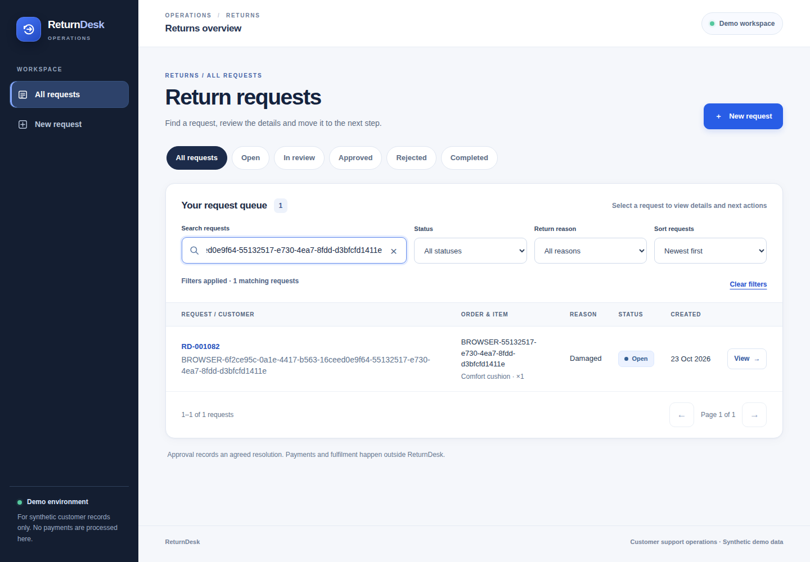
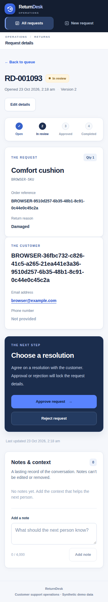

# UI v2 — actual six-screen review evidence

**Source:** `455accfbd2385d315dc567d87aa0d16954056fae`, [CI 39888722084](https://github.com/sohamsadegaonkar/Return_desk/actions/runs/39888722084), job `120203014748`, artifact `12474030697` (`browser-and-server-evidence`). Archive SHA256 **25a841ecd664c73b50a673d992af627294c300e3a9acf2b2bdca5c2529c059de** verified against provider digest. PNGs copied unchanged from isolated CI synthetic fixtures; not hosted, Figma or post-fix captures.

Root and independent UX reviewer inspected all six. No major visual blocker established: all six mobile status chips wrap, long labels remain within cards, mobile decisions precede notes, desktop actions are prominent. Unnamed dialog/faint progress and placeholder findings are corrected in [CP-008](../checkpoints/CP-008-ui-review-accessibility.md), requiring fresh CI. PNGs do not prove keyboard/screen-reader/all-state behavior. Queue sample is a single filtered fixture.

| Screen | Desktop 1440px | Mobile 375px | Review focus |
|---|---|---|---|
| Queue | [Open](evidence/455accf/queue-desktop.png) | [Open](evidence/455accf/queue-mobile-375.png) | Find/filter requests and read rows/cards. |
| Create | [Open](evidence/455accf/create-desktop.png) | [Open](evidence/455accf/create-mobile-375.png) | Contact requirement, item fields, save destination. |
| Detail | [Open](evidence/455accf/detail-desktop.png) | [Open](evidence/455accf/detail-mobile-375.png) | Saved status, legal decisions before notes. |

## Desktop queue

## Mobile detail

## Pixel provenance

| File | SHA256 |
|---|---|
| create-desktop.png | cd56a49df3ea82bd31b973b988831f6ac5f09de557ff9a8e71ea839630efb11d |
| create-mobile-375.png | bb5c0bee7f3be730e856749215f12c6c956e343a7b56f6dd5adbc1a5842de193 |
| detail-desktop.png | a90e25e07f5e9e7db83b5f39f3da9ab36448c219b9bdbf617d2501598fdf0ac9 |
| detail-mobile-375.png | e9486074ea922b29e35fe7b9d2467d6e98002b3b9653490f49434ff97f8261c5 |
| queue-desktop.png | 66d1d45317e1be58c18dcafac1f4930311cbd6a2f58959dc91215812030f552c |
| queue-mobile-375.png | 038d1bce38b29faf60c2e64485d7cbcd304003e68dd12374744fbc4b3d4dffec |

**Owner acknowledgment: PENDING.** Next: qualify CP-008 and obtain specific visual feedback; resolve editable Figma access. PR #9/#1 stay draft; no Render deployment or data reset is part of this review.
